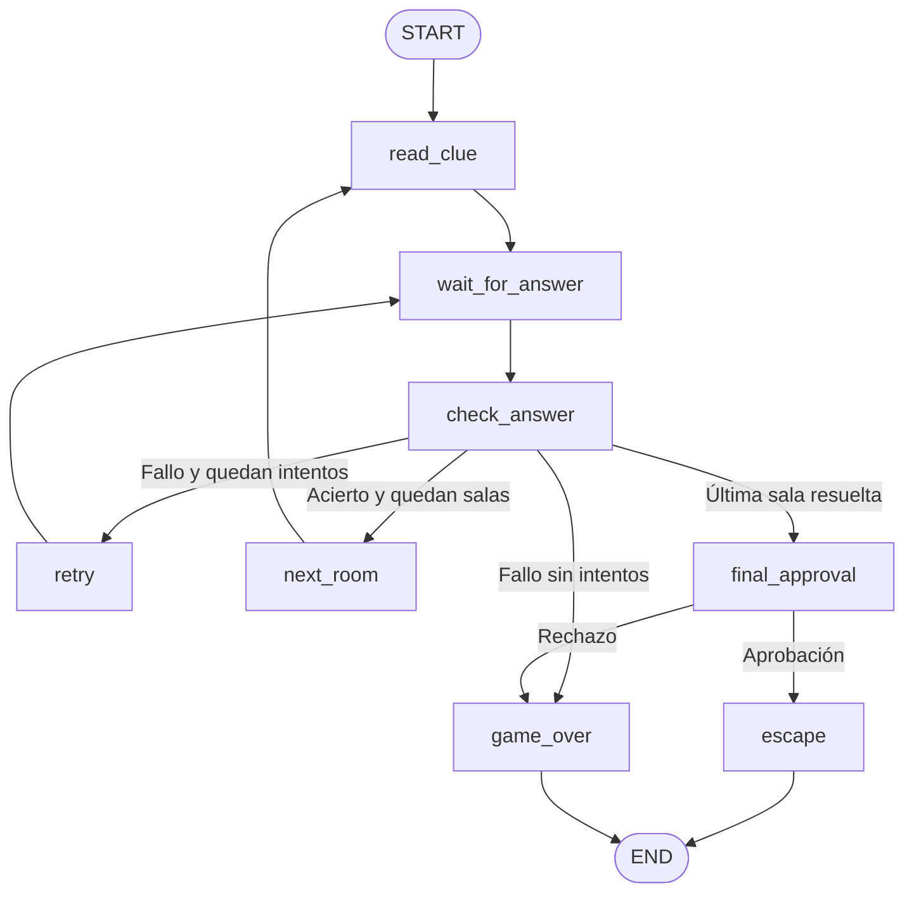

# 🔐 Escape Room con LangGraph

Aplicación interactiva creada con Streamlit, LangGraph y Groq para
aprender a construir flujos con estado, decisiones, ciclos controlados
e intervención humana.

El jugador debe resolver tres acertijos. Cada sala permite hasta tres
intentos y ofrece ayudas progresivas después de los fallos. Al resolver
todas las salas, una persona debe aprobar la apertura de la puerta final.

## Objetivo didáctico

El proyecto sirve como ejemplo práctico para una masterclass dirigida
a desarrolladores junior.

Permite observar:

- Un estado compartido entre los nodos.
- Nodos con responsabilidades concretas.
- Enrutamiento condicional según el resultado de una validación.
- Un ciclo de reintento dentro de una sala.
- Un ciclo de progresión entre salas.
- Condiciones explícitas de finalización.
- Pausas para recibir respuestas y aprobación humana.
- Un LLM utilizado como componente del flujo, no como controlador.
- Validación exacta alternativa si Groq no está disponible.

## 🎓 Presentación y demo online

El proyecto cuenta con dos recursos complementarios:

### Presentación de la masterclass

👉 [Abrir la presentación interactiva](https://masterclasslanggraph.lovable.app)

Explica paso a paso los conceptos principales de LangGraph:

- Estado compartido, nodos y aristas.
- Enrutamiento condicional.
- Ciclos y condiciones de salida.
- Pausas y reanudación de la ejecución.
- Aprobación humana.
- Arquitectura del escape room.

Incluye simulaciones didácticas para ilustrar los conceptos.
Estas simulaciones no ejecutan LangGraph ni consultan un modelo.

### Aplicación práctica

👉 [Jugar al escape room en Streamlit](https://langgraph-escape-room.streamlit.app/)

Aplicación Python que implementa el flujo con LangGraph y permite observar:

- Validación de respuestas con Groq y fallback de reglas exactas.
- Ayudas progresivas y un límite de tres intentos por sala.
- Actualización del estado durante la partida.
- Diagrama del grafo e historial de nodos.
- Pausas para responder y autorizar la apertura final.

### Cómo utilizar ambos recursos

1. Introducir los conceptos con la presentación.
2. Abrir la aplicación de Streamlit y realizar una partida.
3. Observar los cambios de estado, los ciclos y las pausas.
4. Consultar el código para relacionar el comportamiento
   con las funciones y conexiones del grafo.

## Tecnologías

- Python.
- Streamlit: interfaz y gestión de la sesión.
- LangGraph: definición y ejecución del flujo.
- Groq mediante `langchain-groq`: evaluación semántica de respuestas.
- python-dotenv: carga de configuración local desde `.env`.
- Graphviz: representación visual del grafo dentro de Streamlit.

## Estructura del proyecto

```text
langgraph-escape-room/
├── app.py
├── escape_graph.py
├── requirements.txt
├── README.md
├── .gitignore
└── .env                 # Configuración local; no se publica
```

## Instalación en Windows con PowerShell

### 1. Clonar el repositorio

```powershell
git clone (https://github.com/garciaguadalupevanessa-bit/langgraph-escape-room.git)
cd langgraph-escape-room
```

### 2. Crear un entorno virtual

```powershell
python -m venv .venv
```

### 3. Instalar las dependencias

Se puede utilizar directamente el Python del entorno virtual,
sin necesidad de activarlo:

```powershell
.\.venv\Scripts\python.exe -m pip install -r requirements.txt
```

### 4. Configurar Groq

Crear un archivo `.env` en la raíz del proyecto:

```env
GROQ_API_KEY=tu_clave_personal
GROQ_MODEL=identificador_de_un_modelo_disponible_en_tu_cuenta
```

Sustituir ambos valores por la configuración real.

No publicar el archivo `.env` ni incluir claves en el código,
capturas o commits.

Si falta la configuración, falla la llamada a Groq o el modelo devuelve
una salida no válida, la aplicación utiliza respuestas exactas como
alternativa. La interfaz muestra qué validador se ha utilizado.

### 5. Ejecutar la aplicación

```powershell
.\.venv\Scripts\python.exe -m streamlit run app.py
```

Abrir la dirección local indicada en la terminal.

## Demo online

[Probar el escape room](https://langgraph-escape-room.streamlit.app/)

La aplicación permite observar el estado, los ciclos de reintento,
las ayudas progresivas y la aprobación humana final.


## Cómo jugar

1. Leer el acertijo de la sala.
2. Escribir una respuesta.
3. Consultar el resultado y, si se falla, la ayuda disponible.
4. Resolver las tres salas.
5. Aprobar o rechazar la apertura de la puerta final.

Hay tres intentos por sala:

- Primer fallo: primera ayuda.
- Segundo fallo: segunda ayuda, más concreta.
- Tercer fallo: fin de partida.

Los intentos se reinician al avanzar de sala.

La aprobación final es una demostración en la misma interfaz.
No implementa autenticación ni separación de permisos entre
jugador y supervisor.

## Flujo del grafo



Los nodos `wait_for_answer` y `final_approval` contienen pausas
con `interrupt()`.

La interfaz reanuda la ejecución mediante `Command(resume=...)`,
manteniendo el identificador de la partida.

## Visualización de la ejecución

La interfaz ofrece dos pestañas:

- Diagrama: muestra los nodos y los caminos posibles del grafo.
- Historial: muestra el orden de los nodos completados durante la partida.

Los colores del diagrama representan:

- Verde: nodo visitado al menos una vez.
- Amarillo: nodo pausado, esperando una entrada humana.
- Gris: nodo todavía no visitado.
- Azul en FIN: ejecución finalizada.

Las conexiones se obtienen del grafo real de LangGraph.

El diagrama muestra el estado al alcanzar una pausa o finalizar;
no es una animación paso a paso.

Las flechas representan los caminos posibles, no las transiciones
realizadas. Para consultar el orden y las repeticiones de los nodos,
se utiliza el historial.

## Responsabilidades principales

| Elemento | Responsabilidad |
|---|---|
| `GameState` | Define los datos compartidos de la partida |
| `read_clue` | Carga el acertijo |
| `wait_for_answer` | Espera una respuesta humana |
| `check_answer` | Evalúa la respuesta y actualiza el estado |
| `route_after_check` | Decide si reintentar, avanzar o terminar |
| `retry` | Selecciona una ayuda según los intentos utilizados |
| `next_room` | Prepara la siguiente sala |
| `final_approval` | Espera autorización para abrir la puerta |
| `escape` | Finaliza con victoria |
| `game_over` | Finaliza por intentos agotados o rechazo |

El router reutiliza el resultado guardado por `check_answer`;
no realiza una segunda consulta al modelo.

## Pruebas manuales

| Prueba | Resultado esperado |
|---|---|
| Iniciar una partida | Sala 1, cero intentos y espera de respuesta |
| Enviar una respuesta vacía | Aviso sin consumir intentos |
| Fallar una vez | Primera ayuda y dos intentos restantes |
| Fallar dos veces | Segunda ayuda y un intento restante |
| Fallar tres veces | Fin de partida |
| Resolver una sala | Avance y contador reiniciado |
| Resolver todas las salas | Solicitud de aprobación |
| Aprobar | Victoria y finalización del grafo |
| Rechazar | Fin de partida con motivo de rechazo |
| Reiniciar | Nueva partida e historial limpio |

### Soluciones para preparar la demo

1. Sala del cartógrafo: `mapa`.
2. Túnel secreto: `agujero`.
3. Terminal: `teclado`.

## Limitaciones

- Los checkpoints se guardan en memoria, no en una base de datos.
- Las partidas no están diseñadas para recuperarse tras reiniciar
  el proceso.


  ## Estado y próximos pasos

- [x] Validación de respuestas con Groq.
- [x] Ayudas progresivas según los intentos.
- [x] Comprobación del avance y la victoria.
- [x] Comprobación del límite de intentos.
- [x] Comprobación de la aprobación y el rechazo final.
- [x] Diagrama visual integrado en Streamlit.
- [ ] Ensayar el guion completo de la masterclass.
- [ ] Preparar una actividad para que el público modifique el grafo.